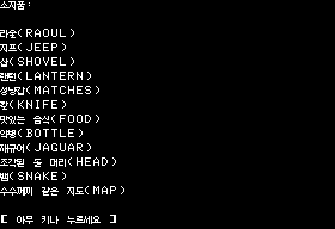
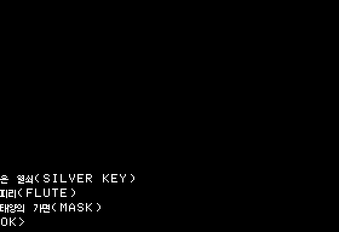

# 인벤토리·매체 안내의 결합 화면 검사

개별 문구의 길이만으로는 목록 페이지나 여러 안내 문구의 합산 높이를 알 수 없다.
이 검사는 원래 LIBRARY의 `!ALTP`, `!INVN`, `!HERE`, `!MORE`와 native 디스크
프롬프트 호출 순서를 직접 추적한 호스트 모델이다. [검사 결과](../evidence/korean/composed-layout.json)는
카탈로그·도구·원본 제어 구간 해시와 각 페이지의 본문 행을 기록한다.

## 인벤토리

원래 소지품 화면은 다른 HGR 페이지를 지우고 행 0에서 시작한다. 첫 페이지에는
제목과 빈 줄이 있고 한 번에 12개 항목을 출력한다. 다음 페이지는 제목 없이
행 0부터 12개씩 출력한다. 각 페이지의 대기 안내는 행 15에 놓는다.

주변 물건 목록은 행 12부터 시작한다. 첫 페이지는 제목 때문에 항목 두 개가
들어가며, 이후 페이지에는 항목 세 개가 들어간다. 마지막 페이지에는 다음 명령의
`OK>` 프롬프트가 놓이고 중간 페이지에는 원래 `!MORE` 대기가 있다.

현재 아이템 표시명 23개는 모두 줄바꿈이 없고 최대 18셀이다. `!OBJL`은 이어 쓰고
뒤의 빈 `.P`가 CR을 출력하므로 **아이템마다 정확히 한 행**을 차지한다. 어떤
아이템 조합을 골라도 이 행수는 늘지 않는다. 각 모드에서 1–23개 항목을 검사한
46사례/141페이지에는 덮어쓰기나 입력 행의 본문 사용이 없었다. 23개를 동시에
소지하거나 같은 방에서 보는 상태가 실제 플레이에서 도달 가능하다는 뜻은 아니다.





40셀에 도달하거나 내부 줄바꿈이 생긴 표시명은 자동으로 거부한다. 제목이 여러
줄로 늘어 본문을 입력 행으로 밀어내는 경우도 검출한다. 해당 회귀 검사를 포함해
호스트 단위 검사 30개가 통과했다.

## 디스크 안내

native A/B 교체 안내는 행 12의 오류, 행 13의 게임 이름+면, 행 14의 드라이브/RETURN,
행 15의 `OK>`로 구성된다. LIBRARY `!CONT`는 행 13부터 게임 이름+면, 드라이브,
대기 안내를 출력한다. 새 런타임의 게임/저장 매체 안내는 행 12–13을 사용한다.
이 여섯 조합 모두 현재 초안에서 본문과 입력 안내가 겹치지 않았다.


한국어 문구를 실제 PARMS/내장 메시지에 패킹한 결과가 아니라 현재 카탈로그의
화면 배치를 확인한 것이다. 매체 목적·버전 확인과 복원 후 재적재의 통합은 별개다.

## 재현과 한계

```sh
python3 tools/korean/audit_composed_layout.py
python3 -m unittest discover -s tools/korean -p 'test_*.py'
```

`build/korean/composed-layout/`에 전체 검사 JSON과 대표 PNG를 생성한다. 단색 그림은
글리프 크기와 행 배치를 보여 주며 실제 HGR 캡처나 아티팩트 색 재현이 아니다.
LIBRARY 제어 구간이 달라지면 고정한 해시 검사에서 실패하므로 모델을 다시 검토해야 한다.

빈 소지품의 안내는 호출 시 커서 위치에 의존하므로 이번 결론에 포함하지 않는다.
실제 페이지 전환·그림 보존, 다른 블록 간 문구 결합, 시간 제한 장면과 전체 게임
실행 검증도 남아 있다. `complete_game_layout_validation`은 false다.
