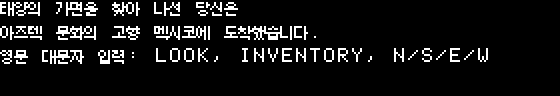
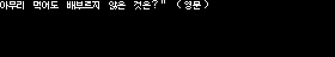

# 영문 입력·수수께끼 검토 기록

2026-10-14. 이 문서는 검수자용이며 아래 접힌 표와 JSON에는 수수께끼 정답이 있다.
플레이어용 자료는 정답이 없는 [입력 안내 초안](input-guide.md)을 사용한다.
아직 사람의 번역 승인이나 전체 한국어판 진행 검증을 받은 것은 아니다.

## 조사 범위

`python3 tools/korean/audit_inputs.py`는 현재 카탈로그와 원본 스크립트를 대조해
[입력 조사 JSON](../evidence/korean/input-audit.json)을 생성한다. START를 제외한
86개 스크립트에서 영문 명령 패턴 337곳, `.A` 질문 5곳, `.=` 비교 10곳,
직접 키 폴링 `.W` 42곳을 기록했다. 동일 DEATH가 양쪽 매체에 있는 원천 위치는
각각 보존한다. 별도의 스크립트 실행이나 모든 분기의 도달 가능성을 증명한 것은 아니다.

카탈로그의 괄호 속 영문 입력명 51곳과 용어집의 23개 입력명을 원래 5문자 단어
패턴과 대조했다. 단순 문자열 부분 일치로 `GO`를 `GOLD`와 혼동하지 않게 검사한다.
상황별 실행 조건은 바뀌지 않는다. 명령 입력은 원래처럼 대소문자를 변환하지
않으며, `.A`는 답의 처음 15바이트를 보관한다. `.=`는 엄밀한 전체 문자열 동등이
아니라 원래 답 접두부 비교다. 이 동작을 번역 과정에서 고치지 않는다.

용어집을 인명·지명·문화 및 아이템 등 40개 용어와 행동 20개로 보완했다.
행동의 영문 명령도 원본 패턴과 대조한다. 이름·장소의 번역 표기는 명령을
새로 추가한다는 뜻이 아니며, 원문의 출처 ID를 용어집에 보존한다.

## 초안 변경과 보존

- 첫 화면의 세 문구 중 앞 두 줄에 원래 도착 설명을 합치고 세 번째 줄에
  `영문 대문자 입력: LOOK, INVENTORY, N/S/E/W`를 표시한다. 새 페이지나 대기를
  추가하지 않는다. 실제 영문 명령 패턴의 존재를 확인했다.
- 세 수수께끼 질문에 `(영문)`을 덧붙인다. 해답은 표시하지 않는다. 첫 수수께끼의
  `buys`는 한국어의 ‘사는’이 거주/생존 의미로 읽히지 않도록 ‘구입하는’으로 고쳤다.
- 유령·노파·행상인·약·거미줄·별·나무에 `GHOST`, `WOMAN`, `PEDDLER`,
  `POTION`, `WEBS`, `STAR`, `TREE` 입력명을 해당 장면에 병기했다.
  기존 `URN`, `PEDESTAL`, `BLOCK` 표기도 원래 패턴과 대조했다.
- B면 34번 방의 `VINE`은 원래 입력 명사로 존재하지 않아 괄호 표기를 제거했다.
  덩굴이 구멍 바닥까지 뻗는다는 단서는 유지한다. 원래 DOWN/구멍 관련 분기는 보존한다.
- `XOTZIL`은 원문이 실제로 공개하는 A면 6번 방의 조각 글자 설명에서 그대로
  보존한다. B면 37번 방의 비밀 단어 요청에는 정답을 새로 추가하지 않는다.
- 69개 항목에 입력 철자를 보호 토큰으로 기록했다. 카탈로그 검사 시 토큰 누락,
  대소문자 변경, 다른 영어 단어의 일부로 바뀐 경우 실패한다. 한국어 조사가
  바로 붙는 `RETURN을` 같은 표기는 허용한다.

검수자용: 원래 질문·답 비교와 단서 보존

| 위치 | 원래 허용 접두부 | 한국어 검토 |
| --- | --- | --- |
| LIBRARY 648행 저장 확인 | `Y` | `(Y/N)` 유지. YES 등 Y로 시작하는 답을 받는 원래 동작을 보존. |
| LIBRARY 666행 복원 확인 | `Y` | 저장 확인과 같은 번역/입력 안내. |
| ROOM 43.0 51행 | `A COFFIN`, `COFFIN`, `A GRAVE`, `GRAVE` | 만드는 자·구입하는 자·쓰는 자의 세 단서 보존. 정답 단어는 번역 화면에 추가하지 않음. |
| ROOM 43.0 70행 | `A FIRE`, `FIRE` | 주어진 것을 먹지만 배부르지 않다는 단서 보존. 정답 단어는 번역 화면에 추가하지 않음. |
| ROOM 43.0 87행 | `A MAN`, `MAN` | 아침 네 다리·낮 두 다리·저녁 세 다리의 비유 보존. 정답 단어는 번역 화면에 추가하지 않음. |

## 용량과 남은 검토

수정 후에도 글꼴은 650개/5,200바이트다. 가장 큰 방별 메시지 풀은 ROOM 43.0의
1,013바이트로 1KB 한계보다 11바이트 작다. 전체 매체 크기 검사에서 A 3/B 6/추가
345섹터가 남는다. 개별 문구와 연속 출력의 행 12/열 0 가정 미리보기에는 넘침이 없다.

지형 명사 전체에 대한 입력 안내, 조작을 추론하기 어려운 분기, 서로 다른 블록의
화면 결합과 번역문만 읽는 전체 플레이는 계속 검토한다. 원래 뱀 장면의 한글 부하
실험은 별도로 통과했지만 이 조사는 유령 등 다른 시간 제한 장면의 실행 검증을
대신하지 않는다. `all_input_guidance_complete`는 false로 유지한다.

