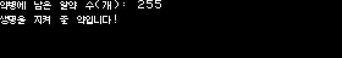

# 한국어 초안 화면 미리보기

이 자료는 K2/K3 준비용 호스트 검사다. 모든 번역은 draft이며 승인하거나 게임
디스크에 적용하지 않았다. [검사 요약](../evidence/korean/layout-preview.json)은
카탈로그·도구·폰트 해시와 검사 범위를 기록한다.

## 재현과 검토

```sh
python3 tools/korean/layout_preview.py
python3 -m unittest discover -s tools/korean -p 'test_*.py'
```

생성된 `build/korean/layout-preview/index.html`을 브라우저에서 연다. 같은 디렉터리의
`images/`가 필요하다. ID·원문·번역·출처를 검색하고 개별 문구/문구 결합을 고를 수
있다. 문맥·출처·제어 정보에는 줄 끝 세미콜론, 번역 메모 및 빈 번역 허용 사유가
포함된다. 번역 수정은 `assets/korean/messages.json` 또는 검수 Markdown을 통해
반영하고 다시 생성한다. 이 페이지 자체는 편집·승인 도구가 아니다.

## 측정 결과

- 비제외 번역 1,327개를 개별 미리보기로 생성했다.
- 소스의 연속 출력 348묶음을 찾아 조건과 아이템 후보를 확장한 403개 조합을
  검사했다. JSON에는 모든 조합을 기록하며 HTML에는 묶음별 대표와 문제 사례를
  표시한다. 현재 표시 항목은 개별 문구를 포함해 1,675개다.
- 행 12, 열 0에서 시작한다는 가정에서 본문이 입력 행을 쓰거나 기존 글자를
  지우는 문제는 0개다. 마지막 행의 의도된 프롬프트는 3개이며 별도로 기록했다.
- 브라우저에서 검색·종류 필터·100개 추가 표시·이미지 적재를 확인했다.
  당시 페이지 재적재 후 콘솔 오류는 0개였다. 이후 기술 안내 두 초안을 추가해
  이미지를 다시 생성했다. 브라우저 검사의 카탈로그 해시는 최신 생성 검사와 구분해
  기록한다. 현재 호스트 단위 검사 30개가 통과했다.

40열 자동 줄바꿈, CR의 현재 셀 지우기, 마지막 행 15 클램프는
`src/renderer.s`의 동작을 모델링한다. 숫자 출력은 최대 255/65535와 원래의
줄 끝 세미콜론을 사용한다. 명령 에코는 36문자, `!OBJL`은 23개 표시명을 각각
대입한다. T/E 조건은 한 연속 출력 묶음 안에서만 분기한다.

원본 숫자 출력이 CR을 추가하므로 알약 수의 단위를 뒤에 놓으면 다음 줄로
분리된다. 이를 피하도록 다음 네 초안을 수정했다.

| ID | 초안 수정 |
| --- | --- |
| `a:LIBRARY:0d37` | `약병에 남은 알약 수(개): ` |
| `a:LIBRARY:0d5e` | `생명을 지켜 줄 약입니다!` |
| `b:ROOM 50.0:035b` | `모험을 마쳤습니다. 남은 알약 수(개): ` |
| `b:ROOM 50.0:038b` | 빈 본문 허용. 의미는 앞 문구로 이동하고 원래 CR은 유지. |




변경 후에도 글리프는 650개/5,200바이트다. 상주 풀은 4,089바이트, 최대 방 풀은
1,013바이트이며 호스트 패킹의 여유는 A 3섹터, B 6섹터다. 94개 인코딩 산출물이
두 실행에서 바이트 단위로 같았다. 자세한 예산은 [인코딩 문서](encoding.md)에 있다.

새 매체 안내 두 초안도 동일한 방식으로 생성했다. 상주 풀에 포함되며 아직 게임에
적용하지 않았다. RETURN은 실제 입력 키 이름으로 유지한다.


## 남은 검사

미리보기는 실제 게임 실행 화면이 아니다. 실제 시작 커서·그림·HGR 페이지,
서로 다른 블록/매크로를 거치는 문구 결합, 인벤토리의 실제 페이지 전환 및 분기의 도달
가능성은 이 검사로 확정하지 않는다. [별도 결합 검사](composed-layout.md)는 목록의
원래 페이지 규칙과 매체 안내를 호스트에서 검증했다. 단색 미리보기는 NTSC 위상 색도 재현하지
않는다. 전체 레이아웃 검증은 아직 미완료다. 소스 출력 목록은 이후
[출력 원천 감사](output-paths.md)에서 완료했으며 실행 검증과 구분한다.

출력 경로 조사에서 발견한 `src/interpreter.s`의 `print_engine_error` 직접 ASCII
호출은 조건부 한국어 경로로 연결했다. 네 오류 진입점을 방 캐시 무효 상태와
두 HGR 페이지에서 [합성 검증](message-runtime.md)했다. 실제 번역 PARMS 패킹은 남아 있다.
부트·재시도 등 새 기술 안내 다섯 개는 카탈로그에 등록했다. 두 개는 번역 초안,
세 개는 초기화·부분 복원 제약에 따른 명시적 제외다.
이 문서는 해당 런타임 통합이 완료되었다는 증거가 아니다.
