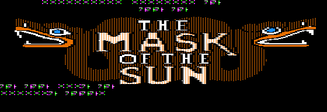

# 원본 로고를 보존하는 제목 자막

2026-10-14. `--full-synthetic --native-ui --title-caption`은 초기 화면의
원본 LOGO1/LOGO2 그림을 그대로 두고, 상단 publisher 행과 로고 사이의
빈 행에 **마스킹된 합성 자막**을 출력한다. 실제 번역을 적용하거나 승인하지 않았다.

## 배치와 비용

INITIAL의 publisher 출력 직후에 `.V 1`, `.H 17`, `.P "~8095`에 해당하는
세 지시문을 넣는다. 메시지 ID와 가운데 열은 고정 상수가 아니라 현재 상주
인덱스와 제목 길이로 생성한다. 이번 제목은 6셀이며 행 1/열 17을 사용한다.
줄바꿈이 있거나 38셀을 넘는 제목은 이 배치로 빌드하지 않는다.

추가되는 것은 참조·커서 지시문 **21바이트**다. INITIAL은 1,763 → 1,784바이트로
2KB 안에 들어간다. 모든 분기와 상대 줄 점프 앞에 삽입하므로 기존 지시문 간
거리와 변수 초기화는 그대로다. 새 키 입력 대기나 런타임 코드를 추가하지 않는다.
글꼴과 상주 풀도 이미 제목을 포함하므로 증가하지 않는다.

24바이트 KOR2 헤더를 포함한 INITIAL 패키지는 1,808바이트다. 섹터 경계를 넘어
A와 추가 디스크의 INITIAL 복사본이 각각 한 섹터 더 필요하다. 최종 합성 배치의
여유는 **A 2/B 6/추가 344섹터**이며 런타임은 1,841바이트다. 용량은 여전히 DOS
세 장 안에 들어가며 ProDOS 전환이 필요한 상황은 아니다.

## 확인한 결과

[콜드 부팅·픽셀 검사](../evidence/korean/title-validation.json)는 실제 추가 디스크로
부팅하며 CPU·월드·스크립트를 주입하지 않는다. 프린터 진입/복귀를 읽기 전용으로
관찰해 다음을 확인한다.

- 자막이 들어갈 행은 원래 비어 있었다. 6글자와 CR이 지우는 마지막 셀의
  56바이트를 예상 글리프와 대조했으며 나머지 HGR **16,328바이트**는 그대로다.
  로고·기존 글자·반대쪽 화면 페이지를 덮어쓰지 않는다.
- 출력 직전 행 1/열 17에서 종료 후 행 2/열 0으로 이동한다.
- 자막 출력 동안 월드 RAM 2KB는 그대로이며 RWTS 요청은 0회다.
- 부팅은 원래 A면 자원 요청까지 진행한다. 캡처의 모든 한국어 모양은 시험 문자다.

[통합 증거](../evidence/korean/title-integration.json)는 새/이전 합성 빌드의 86자원을
대조한다. INITIAL에서 추가한 세 지시문을 빼면 원래 스크립트와 일치하고 다른
스크립트·모든 메시지 풀·글꼴은 같다. A와 추가 매체의 INITIAL도 같은 패키지다.
11개 native 안내 패킹과 49개 보존 파일도 다시 검사했다. 같은 입력의 두 빌드에서
세 디스크와 코드·자산의 10개 파일은 동일하다.

새 세 매체로 66명령 A→B 경로와 B면 같은 세션/새 부팅 복원을 다시 통과했다.
이 결과는 엔딩·모든 시간 제한·실제 번역 화면·실제 하드웨어 검증을 대신하지 않는다.



## 재현

비교 기준은 이전의 native UI 합성 매체다. 다른 카탈로그의 매체는 거부한다.

```sh
python3 tools/korean/startup_disk.py --full-synthetic --native-ui --output build/korean/title-reference-new
python3 tools/korean/startup_disk.py --full-synthetic --native-ui --title-caption --output build/korean/title-media-new
python3 tools/korean/verify_title.py --media build/korean/title-media-new --reference-media build/korean/title-reference-new --output build/korean/title-check-new --rompath /path/to/roms
python3 tools/korean/verify_native_ui.py --media build/korean/title-media-new --output build/korean/title-native-check-new
python3 tools/korean/verify_full_game.py --media build/korean/title-media-new --output build/korean/title-game-new --rompath /path/to/roms --evidence build/korean/title-game-new/evidence.json
```

카탈로그와 검수 묶음 r01은 변경하지 않았다. 승인 후 실제 제목의 화면 검수와
전체 번역 빌드·회귀를 진행한다. 초기화 디스크 교체 안내는 아래 네 행을 사용하므로
초기 크레딧의 표시 지속 시간 등 전체 시작 화면의 사람 검토는 별도로 남아 있다.
