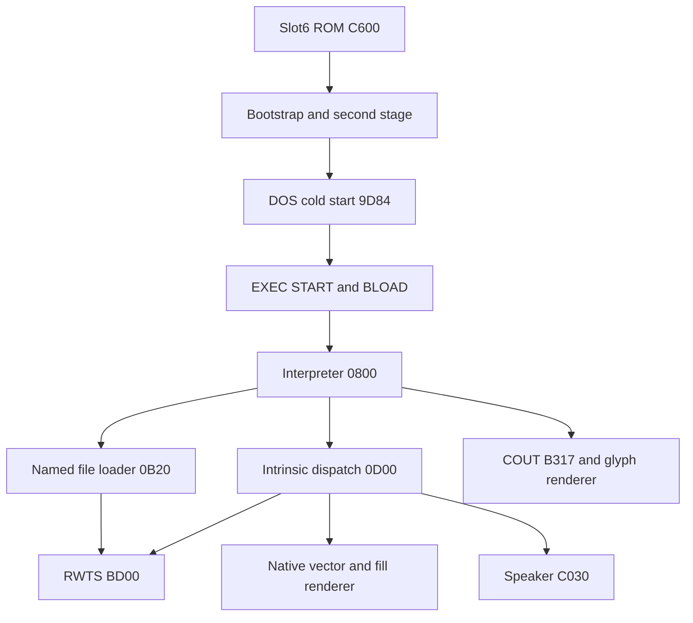

# Memory ownership and engine calls

The target is a 48K Apple II+ with a MOS6502, Applesoft ROM, slot6 Disk II and
no language card. All addresses below are CPU-visible main RAM unless identified
as ROM or I/O. The game retains original fixed addresses and disk access.
Ownership changes during startup; a later graphics buffer is not evidence of
an undisassembled executable overlay. Source assertions and linker maps constrain
code size and placement. Emulator captures include all $0000–$BFFF RAM.

| Span | Startup ownership | Gameplay ownership |
| --- | --- | --- |
| $0000–$00FF | Firmware/Applesoft/DOS scratch | Shared engine pointers and drawing scratch; see below. |
| $0100–$01FF | Hardware stack | Hardware stack, reset to $FF at entry/room restart. |
| $0200–$024F | Firmware input workspace | Normalized five-character words; W points to $0205. |
| $0250 onward | Firmware/DOS input | Raw command buffer; default editor admits36 characters plus CR. |
| $0278 onward | Input workspace | Temporary answer buffer for `.A`, saved response limited15 bytes. |
| $0300–$03EF | Loaded PARMS payload | Prompt, filenames/destinations, helper vectors, errors, chain-word table. |
| $03F0–$03FF | DOS/firmware vectors | Leftover vectors; game installs its own helper/COUT interfaces. |
| $0400–$07FF | Text page1 | Usually hidden; HGR supplies game text. |
| $0800–$0CFF | Bootstrap then interpreter | Resident interpreter and native custom loader/editor. |
| $0CFC–$0CFF | Interpreter final padding | Replaced by the intrinsic file's nominal header. |
| $0D00–$1FFF | Intrinsic load | Resident directives, expressions, sound, vector/fill engine and tables. |
| $2000–$3FFF | HGR1; allocated INTRIN tail reaches $20FB | HGR1, including screen holes. |
| $4000–$5FFF | HGR2 | HGR2. |
| $6000–$600F | Game initializer | A–P scalar bytes. |
| $6010–$601F | Game initializer | GE shared flags. |
| $6020–$611B | Game initializer | T0 object state. |
| $611C–$6217 | Game initializer | T1 object state. |
| $6218–$6313 | Game initializer | TC object containment. |
| $6314–$640F | Game initializer | TL object location. |
| $6410–$650B | Game initializer | TV object value, including pills/mask-use count. |
| $650C–$6607 | Game initializer | N0 room state. |
| $6608–$6703 | Game initializer | N1 room state. |
| $6704–$67FD | Game initializer | NV room state/timers; allocated252-byte array extends through $67FF. |
| $67FE–$67FF | Native scratch | End pointer for appended picture collections; overlaps NV's last two bytes. |
| $6800–$6FFF | INITIAL, later room loads | One current script, up to eight allocated sectors. |
| $7000–$9BFF | LIBRARY load overlaps cleared DOS page | Resident library text,44 sectors. |
| $9B00–$B5FF | DOS command/file manager source | Mostly overwritten: pictures start $9C00 and CHAR GEN starts $ADFC. |
| $9C00–before $AF00 | Startup DOS | Picture collections; selection scanner stops before $AF00. Actual loader bounds follow allocated files. |
| $ADFC–$B6FB | CHAR GEN load overwrites DOS | Legacy fragment, generated lookups, renderer and editable font. |
| $B700–$B7FF | Second-stage loader/IOB | Catalog/TS-list scratch page for custom file loader. |
| $B800–$BFFF | Resident RWTS | Resident RWTS, nibble tables/buffers and auxiliary retained routines. |
| $C000–$C0FF | I/O | Keyboard, speaker, video, buttons and Disk II soft switches. |
| $C600–$C6FF | Slot6 ROM | Boot ROM supplied externally. |
| $D000–$FFFF | Applesoft/monitor ROM | Firmware entry points; no distributed ROM asset. |

The intrinsic allocated header at $0CFC overlaps the interpreter's final four
zero padding bytes; this does not overwrite active parser
instructions. The intrinsic allocated tail is unused data inside HGR1 and is
subsequently cleared/drawn. CHAR GEN's nominal header is loaded at $ADFC; its
payload begins $AE00. Its actual renderer entry is $B300. Both the custom loader
and DOS BLOAD interfaces are documented separately, since only BLOAD honors
nominal binary headers.

## Shared zero page and stack

| Bytes | Owner / lifetime |
| --- | --- |
| $16–$1F | Graphics/text row and saved-register/glyph scratch; renderer X/Y saved $1C/$1D, glyph pointer $1E/$1F. |
| $24/$25 | Text cursor column/row, native renderer. |
| $26/$27 | Glyph scanline pointer; also firmware boot destination before game entry. |
| $2A/$2B | Input buffer pointer; $2B also boot slot before interpreter entry. |
| $33 | Saved output character used by firmware/native output hooks. |
| $36/$37 | COUT vector installed to $B317. |
| $38/$39 | Firmware/DOS input vector during startup. |
| $3E/$3F | Boot ROM-read vector, then DOS sector-buffer pointer; phase-dependent. |
| $40–$49 | DOS file-manager scratch, startup phase. |
| $B0–$B2 | Vector options and packed stream length/count during drawing. |
| $C0–$C5 | Raw input and chain span pointers. |
| $D0/$D1 | Normalized pattern pointer / nested script return context. |
| $D2/$D3 | Script PC. |
| $D4/$D5 | Current script base. |
| $DA/$DB | Library base. |
| $DC/$DD | Normalized command base. |
| $DE | Match result. |
| $DF | Shared input/loader saved index. |
| $E0–$EB | Parser, filenames/string output, expressions, raster fill and RWTS scratch; not persistent world state. |
| $EC/$ED | Loader destination, or fill-pattern pointer during drawing. |
| $EE/$EF | Current room-load base, also shared lower-level scratch. |
| $F0/$F1 | Prompt/parameter pointer. |
| $F2–$F9 | Fixed-point/vector coordinates and scale/direction scratch. |
| $FA–$FF | Graphics/fill/RWTS pointers and temporary values. |

This is a subsystem ownership map, not a promise that firmware or lower-level
RWTS preserves every omitted byte. Routine comments and linked subsystem docs
state register/scratch clobbers. The code is not reentrant. Script subroutines
push the previous pattern pointer high/low; ordinary JSRs share the hardware
stack. The interpreter guards nested calls against entering its lower stack
half. Room transitions/restart reset SP, and intrinsic transfer/conditional
handlers deliberately pop return frames before jumping into resident dispatch.

## Calls, firmware and mutable instructions

The named loader takes A/X=filename low/high pointer and `$EC/$ED`=destination,
returns the next destination page and uses IOB `$0BAB`/DCT `$0BA7`. RWTS takes
A/Y=IOB high/low pointer; carry and IOB+13 report errors. Intrinsic dispatch
receives `$D2/$D3` at the high-bit directive letter. COUT receives character in
A and preserves X/Y through fixed shared cells. All deeper calling conventions
are in [engine.md](engine.md), [intrinsics.md](intrinsics.md),
[renderer.md](renderer.md), [dos.md](dos.md) and [rwts.md](rwts.md).

Monitor calls include COUT `$FDED`, CROUT `$FD8B`, bell `$FBE2`, WAIT `$FCA8`,
backspace `$FC10` and optional autostart `$FAA6`; DOS additionally uses BASIC
vectors/templates recorded in source. Video uses `$C050` graphics, `$C052` full
screen, `$C054/$C055` page selection and `$C057` HGR. Input reads `$C000` and
clears `$C010`; script Z maps `$C061` button0. Audio toggles `$C030`. RWTS touches
slot-indexed `$C080`–`$C08F` Disk II phase/motor/drive/Q6/Q7 switches, with native
timing loops retained. No extra hardware reads are made merely for replay
predicates; predicates inspect RAM or passive bus records.

Mutable code is intentional: renderer state at `$B375`–`$B378`, loader error
patch `$0BD1`, intrinsic vector branch/operator/call operands, sound period and
duration fields, and several DOS/RWTS saved operands. Source labels identify
instruction+offset writes, keeping instruction bytes assembled. Script macro
substitution mutates room/library text separately. Save transfers `$2000–$AFFF`,
so screenshots, world arrays, room/library scripts and loaded pictures are saved;
resident interpreter/intrinsic/RWTS/font code is not replaced by a save image.
